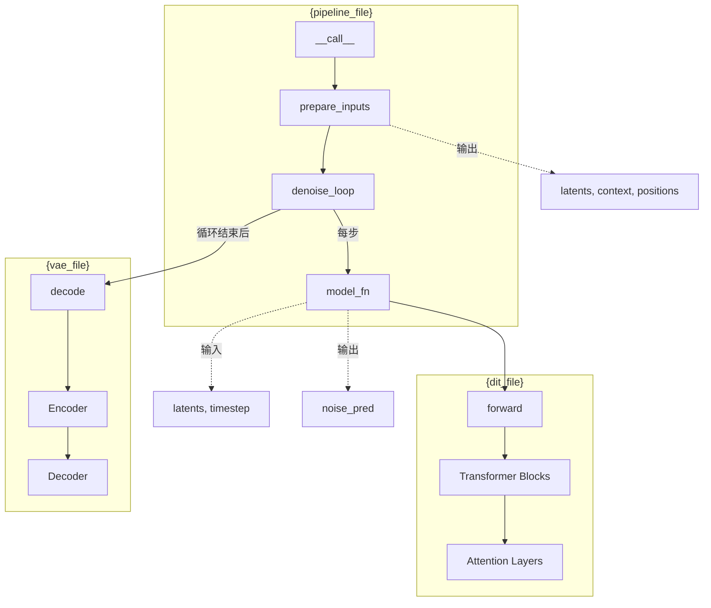

# 代码阅读报告模板

## 1. 项目结构速览

```
{target_path}/
├── {models_dir}/          # 模型定义
│   ├── {model}_dit.py    # DiT 模型
│   ├── {model}_vae.py    # VAE 编码器/解码器
│   └── ...
├── {pipeline_dir}/        # Pipeline 定义
│   └── {model}_pipeline.py
├── {examples_dir}/        # 示例脚本
│   └── inference.py
└── README.md
```

## 2. 入口点指引

**主入口**：`{main_entry_file}`

**关键文件阅读顺序**：
1. `{file_1}` — 职责说明
2. `{file_2}` — 职责说明
3. `{file_3}` — 职责说明

## 3. 核心类说明

| 类名 | 文件 | 职责 | 与 DiffSynth 的映射 |
|------|------|------|-------------------|
| `{ClassA}` | `{file_a}` | 描述... | 对应 DiffSynth 的... |
| `{ClassB}` | `{file_b}` | 描述... | 对应 DiffSynth 的... |

## 4. 运行链路图解（Mermaid 流程图）

### 主流程

```mermaid
flowchart TD
    A[用户输入<br/>prompt, seed, ...] --> B[Text Encoder<br/>encode prompt]
    B --> C[Noise Init<br/>初始化 latent]
    C --> D[Timestep Scheduler<br/>设置推理步数]
    D --> E[Denoise Loop<br/>循环去噪]
    E -->|每步调用| F[DiT Forward<br/>预测噪声]
    F --> G[VAE Decoder<br/>解码 latent]
    G --> H[输出<br/>image/video/audio]
    
    %% 标注调用文件
    B -.->|调用| B1[`{model}_text_encoder.py`]
    F -.->|调用| F1[`{model}_dit.py`]
    G -.->|调用| G1[`{model}_vae.py`]
```

### 详细调用链



### 控制流

```mermaid
flowchart TD
    A[开始] --> B{cfg_scale > 1?}
    B -->|是| C[Classifier-Free Guidance<br/>合并正负提示]
    B -->|否| D[跳过 CFG]
    C --> E[Denoise Step]
    D --> E
    E --> F{是否最后一步?}
    F -->|否| B
    F -->|是| G[结束]
    
    %% 标注关键代码位置
    C -.->|见| C1[`{file}:{line}`]
    E -.->|见| E1[`{file}:{line}`]
```

## 5. 关键代码段

### 5.1 DiT Forward

**位置**：`{dit_file}:{line_start}-{line_end}`

```python
# 关键代码片段
```

**说明**：这段代码做了什么，与 DiffSynth 标准的差异在哪里。

### 5.2 VAE Encode/Decode

**位置**：`{vae_file}:{line_start}-{line_end}`

```python
# 关键代码片段
```

**说明**：...

### 5.3 Pipeline 主循环

**位置**：`{pipeline_file}:{line_start}-{line_end}`

```python
# 关键代码片段
```

**说明**：...

## 6. 与 DiffSynth 的映射

| 目标库组件 | DiffSynth 对应 | 差异说明 |
|-----------|---------------|---------|
| `{target_class}` | `diffsynth.models.{model}_{component}` | 差异... |
| ... | ... | ... |

## 7. 快速开始

**运行目标库 example**：
```bash
cd {target_path}
python {example_script}.py --prompt "..." --seed 42
```

**预期输出**：...

## 8. 注意事项

- 特殊依赖：...
- 与标准扩散的差异：...
- 接入时需要特别注意：...
