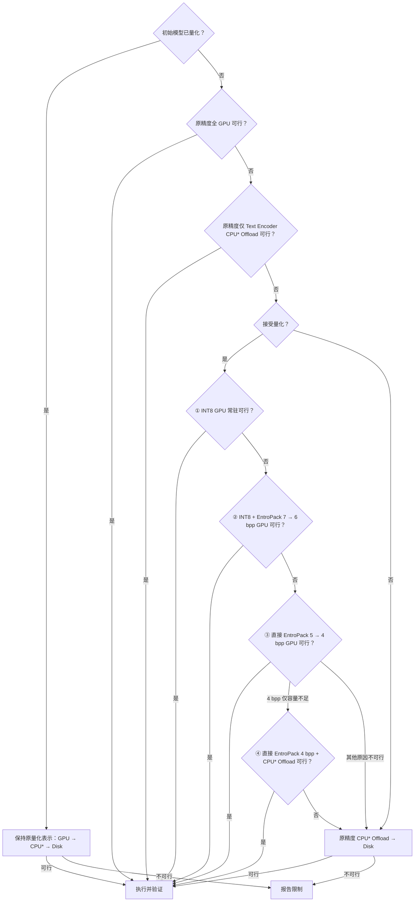

# DiffSynth-Studio 用户推理

根据用户目标和实际 GPU、RAM、磁盘条件，修改对应的官方 example，交付可独立执行的脚本；用户要求运行时，完成推理并检查实际产物。

按以下七步完成任务。交付脚本应保持 `examples/<系列>/model_inference/` 或 `model_inference_low_vram/` 的形式：imports → 必要的量化/Offload 配置 → `from_pretrained` → 输入与 Pipeline 调用 → 保存。环境探测、配置决策、监测和验证在脚本外完成，不要求生成候选计划、模块清单或资源契约 JSON。

## 步骤 1：确定用户目标

确认以下信息，优先从用户说明、现有脚本和本地文件获取：

- **模型**：精确名称、变体、checkpoint/revision 或本地权重路径。
- **任务和输入**：生成、编辑、控制、LoRA 或批量；prompt、图片、视频、音频及其他条件。
- **输出规格**：尺寸、帧数/时长、步数、seed、数量和保存目录，以及质量、耗时或吞吐约束。
- **已有精度要求**：记录用户已明确的 dtype、量化许可、质量/最低位宽限制；未指定时先沿用普通 example 的原生精度，不为此打断任务。
- **执行范围**：只准备脚本，还是实际运行并生成结果。

先确认 checkpoint 是否已经量化、设备是否为统一内存架构。浮点底模默认先用普通 example 的原精度 + GPU 常驻；独立显存设备不足时先检查原精度 + 仅 Text Encoder CPU Offload。任一方案可行就直接推理，不为未知精度许可打断。仅在这些适用的原精度方案均不可行、且量化许可未知时，询问是否接受 DiT 与 Text Encoder 同时量化及质量/最低精度限制。已有答复沿用；等待期间可检查资源与后端，不新增有损转换。预量化模型跳过新增量化与这项询问；统一内存设备跳过全部 CPU Offload 分支。

缺少具体模型或影响任务兼容性的关键信息时询问。其余未指定的生成参数沿用匹配 example 的值或实际 Pipeline 默认值，并说明采用的值。不自行换模型、变体、量化 checkpoint 或降低用户明确要求的规格。

先通过模型注册、checkpoint 的量化配置/metadata 和匹配 example 判断是否预量化，不只看文件名；只准备脚本时不为确认真实模块格式而加载模型，证据不足则标记待验证。实际加载后再核对模块与 packed 格式。预量化模型保留原方法、位宽、敏感层和必需的 `load_prequantized` / 注册 `quant_config`，不重新选择 INT8/EntroPack、不对 packed 权重二次套量化，也不顺带量化其余浮点组件；显存不足只评估保持现有表示的兼容卸载。下述自动量化仅适用于原始浮点模型；用户明确要求重新量化或转换时另按该任务处理。

## 步骤 2：找到并读懂对应的官方 example

定位用户正在使用的 DiffSynth-Studio 源码，先搜索 `examples/`：

```bash
rg --files /path/to/DiffSynth-Studio/examples | rg 'model_inference(_low_vram)?/.*Z-Image-Turbo'
rg -n 'class ZImagePipeline|def from_pretrained|def __call__' /path/to/DiffSynth-Studio/diffsynth/pipelines/z_image.py
```

将上面的模型名和 Pipeline 路径替换为实际目标，优先选择**变体和任务同时匹配**的脚本。先完整阅读普通版；进入低显存路线后再完整阅读对应低显存版及本 Skill 的参考文档。随后按需查对应 Pipeline、模型文档、模型注册和显存管理映射，确认：

- `from_pretrained` 的全部模型组件，以及单独的 tokenizer、processor 等辅助资源。
- LoRA、控制组件、输入预处理、推理调用和产物保存方式。
- 实际接口支持的参数、默认值、组件级 dtype、调度和解码要求。

不能只根据相似文件名推断兼容性。没有完全匹配的 example 时，结合相近示例与真实接口确认支持后再改；不支持的任务如实说明，不虚构参数。记录所选 example 路径，便于交付时追溯。

## 步骤 3：探测目标硬件和运行环境

使用**实际执行推理的 Python** 运行随包工具，路径替换为实际绝对路径。先根据目标模型、输出规格和已有峰值证据确定非权重峰值与安全余量，将实际 GiB 数值赋给 `TASK_RESERVE_GIB` 后执行；工具默认的 0.5 仅为最低参考，不能直接套用于所有模型：

```bash
/path/to/python /path/to/diffsynth-user-inference/scripts/probe_environment.py \
  --studio /path/to/DiffSynth-Studio \
  --model-dir /path/to/models --output-dir /path/to/task \
  --torch --import-diffsynth --reserve-gib "$TASK_RESERVE_GIB" \
  --output /path/to/task/environment.json
```

检查 Python/PyTorch、实际导入的 DiffSynth 来源、目标 GPU 的型号/总显存/空闲显存/计算能力、可用 RAM（含 cgroup 限制）、模型与输出盘空间，以及所选后端依赖。读取目标 `devices[].memory_architecture.kind` 与 `.evidence`：`unified` 跳过 CPU Offload；`unknown` 结合设备规格或用户已确认的架构核实，不能因支持统一寻址/managed memory 就认定物理内存共享，也不能把所有 MPS 设备都当作 Apple Silicon。远程任务在远程目标探测，多卡逐张确认；不能把多卡显存直接相加。

探测后必须读取 `environment.json`；退出码 0 只代表探测程序完成。按以下状态处理：

| 检查 | 处理 |
| --- | --- |
| `diagnostic_status` 与 `errors` | `partial` 时定位受影响项目；无关设备故障不应覆盖目标设备已知事实，未知项仍需注明 |
| `import_test` 的来源检查 | `requested_source_import_verified=false` 时，结合 `status`、实际 `origin`、`requested_source_match` 和 `distribution_origin_match` 判断。导入成功且实际路径匹配目标源码、仅安装元数据不一致时，记录差异，不反复修复已正确的导入；实际导入失败、路径不符或来源未知时再修复/核实并重新探测。`--studio` 不会自动切换 Python 导入路径 |
| `device_probe_status` 与目标 `devices[]` | 检查所选卡的查询结果；失败时不能假定该卡可用，多卡部分成功也不能代表所有卡通过 |
| `ram` 与 `storage` | 分别读取主机值、cgroup 及有效内存状态、模型/输出盘状态。限制未知时不能将主机 RAM 当作任务可用量，磁盘剩余量也不代表配额已验证 |

只准备脚本且环境未安装时，可省略 `--torch --import-diffsynth`，明确 `not_requested`/待验证条件。缺依赖时列出最小修复需求，按已有环境配置授权处理，不默认升级或替换 Python/PyTorch/CUDA。

`diagnostic_status=collected` 仅代表基础事实采集完成，`target_readiness=not_assessed` 仍表示模型未验证。检查该模型要求的 Python、PyTorch、CUDA/ROCm 和所用后端；Attention、量化等自定义算子的兼容性无法由源码/版本确认时，实际推理前先做针对性小算子测试，未测能力保留 `not_tested`。工具自身不下载权重或测试这些算子。

工具在目标 `devices[].memory_budget` 中直接输出 `reserve_gib`、`new_task_budget_gib` 和 `vram_limit_gib`。预算不足时返回 `status="no_weight_budget"`，非正预算截为 0，不能据此宣称能运行。若驱动返回 free>total 等不一致数据，预算为 `unavailable`/null，保留原始数据和错误；先复核目标设备，不据此选档。`--reserve-gib` 是本次任务的非权重峰值与安全余量，默认 0.5 仅为最低参考；MiniMax-H3 至少 2 GiB，其他官方 example 的更大余量也应保留。依据实际尺寸、帧数、Attention、解码和临时反量化峰值增大，不能用默认值保证整个任务可运行。

需要模型体积时，可追加多次 `--weight-file /path/to/component-shard.safetensors`。工具只读本地文件头，逐文件输出 `tensor_data_bytes`、`numel_by_dtype`、`largest_tensor_bytes` 和 `floating_2d_weight_numel`；不下载权重或把权重读入 RAM/GPU。必须由 Agent 将实际分片归到对应组件，结合模型结构、converter 和敏感层确定可量化参数；二维权重包含 embedding，不能全部视为 Linear。已打包量化文件的元素数也不是原模型参数量。没有本地权重时使用可信的模型配置/文档，不为估算强制下载全部权重。

统一内存的 RAM 与 GPU 存储不相加，也不分别扣两次同一份权重；结合有效系统/cgroup 余量、设备工作集/分配器限制和任务峰值取共同允许的预算。MPS 的推荐工作集是约束参考，不能当作已保留的空闲量；没有 CUDA `free_bytes` 时不虚构该值。CPU 存放只改变访问位置，不视为新增容量；兼容 Disk 仍可单独评估。

环境报告不等于配置推荐；下面的核心计算负责把显存事实与目标组件联系起来。运行前重新查询，快照不是资源预留，多卡显存不能直接相加。

## 步骤 4：先分流模型与内存架构，再选配置

低显存决策前阅读 [显存优化参考](references/memory-optimization.md)。按以下顺序判断；权重下界或同规格实测已确认不足时直接跳过。准备/峰值未知但无硬冲突时可按运行授权验证，不故意逐档 OOM。

1. **先分流**：预量化模型保留现有表示，跳过以下新增量化和精度许可逻辑；先评估常驻，不足时独立显存设备检查现有表示的 CPU Offload，再检查兼容 Disk。统一内存设备跳过所有 CPU Offload，只评估常驻和兼容 Disk；无合规方案就报告限制。
2. **浮点底模原精度 + GPU 常驻**：保留普通 example 的 dtype，不添加量化、Offload 或无效的 `vram_limit`。可行就推理。
3. **原精度 + 仅 Text Encoder CPU Offload**：仅对独立显存设备评估；DiT/VAE 常驻，Text Encoder 保持原精度。整组件编码峰值不满足时，检查受支持的逐层调入与阈值；同时核对 RAM、准备、编码、去噪、解码峰值。没有 Text Encoder 就跳过。可行即执行，许可量化也不提前降精度。
4. **适用的原精度方案均不足**：量化许可未知才询问，已知则沿用。拒绝量化走原精度卸载；接受量化走路线 A。统一内存设备不经任何 CPU 回退。



主图用于默认资源与兼容性选择；“仅容量不足”包括常驻空间不足，以及可通过逐层量化准备缓解的 GPU 准备峰值不足，不包括后端不兼容。CPU* 仅适用于独立显存设备。运行后发现质量不合格时，按路线 A 的质量纠偏规则及步骤 6 恢复，不在主图增加质量选档。

图中 4 bpp + CPU 不可行后的回退，若有与用户指定模型、变体及 revision 来源匹配、质量合格且允许使用的预量化 4 bpp checkpoint，可优先检查其兼容 Disk Offload；否则从原始浮点权重评估原精度 CPU/Disk。不得仅因名称相似替换 checkpoint；在线量化不能直接搭配 Disk。

### 核心计算：按组件和阶段估算

以下为独立显存设备，全部用 GiB（`1024**3` 字节）；统一内存按步骤 3 的单一共享预算处理：

```python
G = free_bytes / 1024**3
B = G - reserve_gib  # 覆盖激活、工作区、临时反量化与安全余量
W_native = sum(n * dtype_bytes for n, dtype_bytes in component_groups) / 1024**3
# 对每个 DiT / Text Encoder 分别计算；Nq 为真实可量化 Linear.weight 元素数
# U 包括未量化 embedding、norm、bias、敏感层和缓冲区
W8_component = U_component + Nq_component / 1024**3 * 1.10
Wep_component = U_component + Nq_component * bpp / 8 / 1024**3 + metadata_gib
W_quant_gpu = sum(quantized_component_weights) + W_vae + W_other_gpu
# 有依据地选最高可行档，不逐档完整试跑；默认仅这些整数档
entropack_candidates = [
    (7.0, "entropack_lossy_quant_int8"),
    (6.0, "entropack_lossy_quant_int8"),
    (5.0, "entropack_lossy_quant"),
    (4.0, "entropack_lossy_quant"),
]
```

`1.10` 是缺少后端精确数据时的 INT8 状态/对齐开销估算，不是实测保证。EntroPack 按选中方法的真实 packed 数据、scale、编码表、header 和缓冲核对；二次量化还含 INT8 scale/状态，不能直接沿用普通 EntroPack 同 bpp 的峰值。保留整数缓冲与组件特殊 dtype，不将压缩比例应用于 VAE 或整个 Pipeline。

- **常驻**：权重小于 B 仅说明可作候选；仍核对在线准备、运行与解码峰值。DiT 和 Text Encoder 全部计入 GPU，不能减掉编码器。
- **仅 Text Encoder 卸载**：编码峰值仍包含常驻 DiT/VAE、当前调入的编码器权重及临时量，不能从全 GPU 峰值直接减去编码器大小。
- **4 bpp + CPU**：CPU 计入 packed 模型、未压缩组件和浮点准备副本；GPU 计入当前 packed 层、临时解压、激活、仍常驻组件与缓存。不能把常驻权重公式当成流式运行峰值，也不能声称零显存。
- **选档**：两类组件默认同方法、同 bpp。按默认优先级筛选资源与后端兼容性；已有可靠质量证据时排除已知不合格的候选，质量未知时不阻塞资源选档，在实际生成后评估。默认不插入半整数或低于 4 bpp 的档位，不为预先比较质量而逐档完整试跑。较低 bpp 不保证完整任务峰值或速度更好。

例如，可量化 BF16 权重合计 16 GiB，其余 GPU 权重 U=2 GiB：free=16、余量 3 时 B=13，INT8 约 10.8 GiB 可作候选。若 free=10，则 B=7，普通 EntroPack 格式开销合计 0.2 GiB 时，5 bpp 约 7.2 GiB 不足，4 bpp 约 6.2 GiB 可作候选；仍需核对准备、实际峰值和质量，不是通用阈值。

`vram_limit = total_bytes / 1024**3 - reserve_gib` 只用于实际启用显存管理的组件，框架比较整卡已用量（含其他进程），不是硬额度；不能直接用 B 替代。常驻方案不添加它。统一内存不套用“CPU 权重不占 GPU 存储”的估算。

### 路线 A：接受量化，两类组件同步配置

- **INT8 常驻优先**：全部 DiT、Text Encoder 使用 `torchao_int8_w8a16`，分别保留真实敏感层；VAE/其他组件保留官方 dtype。检查实际量化命中，不静默只量化一个组件。
- **7 / 6 bpp 二次量化**：使用 `QuantizeConfig(method="entropack_lossy_quant_int8", backend_config_kwargs={"target_bpp": bpp})`，后端内先做 INT8 量化，再对量化码编码。它是 **W8A8**，包含激活量化；不是对 torchao 已量化模块再套一次配置，也不是 `MixedQuantizeConfig`。核对 SM8.0+、实际 kernel 与画质；可能提速，不承诺普遍快于直接量化。INT8 W8A16 不兼容时，不能据此推断此路径也必然失败或成功。
- **5 / 4 bpp 直接量化**：两类组件均使用 `entropack_lossy_quant` 与对应 `target_bpp`；不经过前置 torchao INT8。每次从原始浮点权重准备，避免累计有损转换。7/6 不兼容时可继续检查独立的 5/4 方法。
- **先常驻，再 4 bpp + CPU**：INT8 和上述 EntroPack 常驻方案不足，且 4 bpp 方法兼容、无已知不可接受的质量退化、问题仅是容量时，独立显存设备采用双组件 **直接 EntroPack 4 bpp + CPU Offload**。保留两类组件的 packed 格式，按需从 Text Encoder 扩大到 DiT 逐层调入，核对映射、RAM、在线准备及最低计算峰值。因 OOM 尚未生成产物时，质量仍待验证，不能判为质量失败；资源可行则先以 4 bpp + CPU 生成，再检查质量。默认容量路线不增加 INT8/7/6/5 bpp CPU 中间态。
- **量化 + CPU 的生效条件**：4 bpp 容量路线和下述更高 bpp 质量纠偏均须核对实际调入粒度。逐层方案确认目标组件有适用的细粒度显存管理映射，使用 `cpu_dynamic` 使 offload/onload 在 CPU、preparing/computation 在 GPU，并为 Pipeline 设置按上述公式计算的有效、非 `None` 的 `vram_limit`；`None` 会允许已调用层持续缓存在 preparing 设备上。实际核对量化层的 CPU/GPU 迁移及缓存阈值；没有适用映射时检查整组件调入峰值，整组件仍放不下则不能认定方案可行。阈值不是显存硬上限，仍需容纳临时权重与计算峰值。
- **运行后质量纠偏（不改变默认选档顺序）**：仅适用于本轮从浮点底模新增的量化。量化方案完成推理，但结果相对用户要求或可信基线出现明确且不可接受的质量退化时，先核对量化方法、两类组件的实际命中层与敏感层、输入及解码设置，排除配置错误；保持 prompt、条件输入、seed、步数、输出规格及其他生成参数可比。

  确认问题与量化精度有关后，提高量化精度，并按资源需要结合 CPU Offload。直接 EntroPack 4 bpp 可优先评估直接 5 bpp + CPU；必要时再根据质量证据评估 INT8+EntroPack 6/7 bpp + CPU。若候选可常驻则保持常驻；每个候选仍须满足量化许可、质量/最低位宽、激活精度、RAM、GPU 准备与运行工作集及后端兼容性要求。5/4 bpp 的直接方法与 7/6 bpp 的 INT8 W8A8 计算路径不同，不能仅凭 bpp 更高就断定画质更好；依据已有同模型质量证据缩小范围，不要求逐档完整试跑。

  这是特殊恢复规则；[显存优化参考](references/memory-optimization.md) 中仅采用 4 bpp + CPU 的选择限制适用于默认容量路线；其中“质量合格”的选档要求仅用于已有可靠证据的候选，质量未知时按本节先选资源配置、生成后评估。实现可复用其中的 `cpu_dynamic` 模板，重新构造对应的 `QuantizeConfig`，遵守上述 CPU 生效条件。每次改变方法或 bpp，先释放失败模型，再从原始浮点权重重新加载，不能在已有量化结果上累计转换，也不能转回 BF16 冒充恢复原精度；重新生成计入步骤 6 的总尝试次数。
- **统一内存例外**：直接跳过 4 bpp + CPU 和仅 Text Encoder CPU；常驻不足检查兼容 Disk，不能以 CPU“卸载”声称扩容。EntroPack/torchao 的 CUDA kernel 不能直接用于 MPS；无兼容后端就排除相应档位。
- **后端/质量失败**：Offload 不能修复量化算子不兼容，也不能消除相同量化表示的数值误差。后端不可用时排除该方法，检查后续兼容候选；质量不合格先按上述规则提高精度。无合规纠偏候选或有限恢复仍不满足要求时，从原始浮点 checkpoint 重载、去掉新增 quantize，评估原精度卸载。统一内存跳过所有 CPU Offload，包含质量纠偏候选；用户禁止 Offload 时排除 CPU/Disk，限定方法、质量或耗时时同样优先遵守，无合规方案则报告限制。

### 卸载：保持所选表示，按内存架构分流

- **拒绝量化或无合规量化/质量纠偏候选**：从浮点源使用原精度；独立显存设备先 CPU，RAM 不足再检查原精度 Disk；统一内存跳过 CPU。阶段 dtype 保持原生，不使用 FP8 onload/preparing 暂存。
- **4 bpp + CPU 的资源仍不足**：按图下说明，仅对来源/revision 匹配、质量合格且允许使用的已有 4 bpp 预量化包优先检查 Disk 路径，同时核对原 method、敏感层和完整量化状态。在线量化 + Disk 不支持；保存预量化包是独立准备任务，必须评估 GPU/RAM/空间，不能因为最终 4 bpp 小就启动已知放不下的转换。没有合规包、准备资源或兼容 Disk 路径时，从原始浮点权重评估原精度 CPU/Disk，明确表示已改变；仍不可行则报告具体限制。
- **最初已量化**：不新增、重选或二次量化，保留实际 method、packed 状态与加载配置。独立显存可在兼容时卸载现有表示；统一内存仅检查常驻/Disk。保持已有表示的加载、搬运不属于本轮新增量化。
- **共同条件**：Disk 必须检查格式、转换器、完整分片、最小计算层、解码与 I/O；它不解决当前计算层和激活也放不下的问题。组件生命周期、细粒度映射、特殊 dtype 和固定 checkpoint 始终保留；没有的组件不虚构。历史不同方法、编码器驻留或解码规格的峰值不能混用。

## 步骤 5：修改并交付可执行脚本

复制匹配的官方 example 到用户任务目录，例如 `/path/to/task/infer.py`，保留来源说明。修改副本，保持上游原始 example 完整。

以 example 的最小差异为交付标准：

- 保留 imports 顺序、顶层顺序执行结构、变量命名风格、完整组件、tokenizer/processor、预处理、Pipeline 调用和保存方式；不重构为类、函数、CLI 或通用配置驱动程序。
- 只替换本次输入/输出、必要的本地权重路径、用户要求的推理参数，并只写入已选中的配置：原精度全 GPU、原精度仅 Text Encoder 卸载、双组件量化常驻、直接 EntroPack 4 bpp + CPU、运行后质量纠偏选定的更高精度量化 + CPU，或保持所选表示的兼容卸载；统一内存不生成 CPU Offload 配置。仅新增这些配置需要的 import、短列表/字典和必要注释；不生成多路线 `if/elif`，脚本直接表达已经选好的一个方案。
- LoRA、控制和 tiled 解码仅在本次任务需要且接口支持时调整；移除无关演示和独立数据下载，不改变本次任务的处理与保存流程。
- 不把环境探测、自动选档、依赖安装、显存采样线程、分配器限额、阶段 hook、模块计数、JSON 报告或包住全流程的 `try/except/finally` 写进交付脚本。这些属于执行/测试工具，在外部命令或独立测试包装器完成。模拟小显存的限额也只放测试包装器。
- 运行环境变量、GPU 选择与源码导入路径放运行命令，例如 `DIFFSYNTH_MODEL_BASE_PATH`、`CUDA_VISIBLE_DEVICES`、`PYTHONPATH`；不把机器探测、`sys.path` 注入或自动 monkey patch 固化到模型脚本。必要的依赖兼容修复另行记录和处理，不能悄悄删掉后宣称当前环境可运行。

交付前与所选 example 对比，确保每一处差异均由输入/输出或本次推理配置解释。来源与选档说明放交付文字或短注释，不塞入大段测试元数据。

本地分片按实际文件集合传给 `ModelConfig(path=...)`，tokenizer/processor 使用真实目录，不能遗漏分片或把同一目录误当作任意组件。离线运行前检查所有资源；跳过模型下载的开关不能阻止示例里的独立数据下载或其他联网代码。

执行前核对模型、LoRA、条件输入及输出规格，并保留可检查的运行证据：

- **模型**：对照实际解析的 checkpoint/分片、组件加载日志和必要的 revision 信息，确认变体/来源。结构 hash 只能帮助类型识别，不能证明权重内容或 revision 一致。
- **LoRA**：核对目标组件、真实参数（如 `load_lora(alpha=...)`）、量化加载顺序与融合/hot-loading 路径。检查加载器报告的匹配数量和实际目标层；hot-loading 可检查目标模块的 `lora_A_weights`/`lora_B_weights` 已挂载，融合路径检查匹配日志或目标参数确有预期更新。预期加载却匹配 0 层或层集合不符时，先修正再运行；alpha=0 等用户明确指定的关闭状态另行标明。
- **条件与输出**：记录本次实际传入 Pipeline 的参考图/视频/音频/控制参数、输入来源与必要形状，确认被对应处理 unit 消费；核对 seed、尺寸、数量、保存路径和编码帧率，不能只检查文件存在或变量已定义。

不同加载器的返回值与可观测状态以活动源码为准。无法取得证据时标记“未验证”，不能因媒体通过就宣称模型/LoRA/条件已生效。仅在确有疑问且运行范围允许时做启用/关闭对照，不强制额外完整推理。

复用已有产物时，核对任务 ID、模型/输入/参数记录，并按事先确定的规格解码验证，不能仅凭文件存在或 seed 相同就跳过。成功项保留；失败/来源不明的旧文件另存或备份后重跑。批量使用固定 ID/seed 和独立路径记录成功/失败，单项重试也不静默覆盖已验证成功结果。

生成完整、可独立执行的脚本及运行命令，注明所需 Python 环境和工作目录。例如：

```bash
cd /path/to/DiffSynth-Studio
/path/to/python /path/to/task/infer.py
```

## 步骤 6：按用户范围执行，有限恢复失败

**只准备脚本**：不下载或运行模型，进入步骤 7 交付，明确“尚未执行”。

**要求运行**：重新查询设备资源，在目标环境执行完整目标规格并保留外部日志。需要显存监测时，用独立进程采样设备占用；需要精确 PyTorch 峰值时，由独立测试包装器在同一进程加载前重置统计、通过 `runpy.run_path(script_path, run_name="__main__")` 执行脚本，保持目标运行命令的工作目录与 `sys.argv`，结束同步后读取 `max_memory_allocated`/`max_memory_reserved`，不修改交付脚本。前者是采样峰值且可能含其他进程，后者只代表该进程 PyTorch 分配器。任务参数、配置生效证据、阶段和 RAM 快照记录在外部运行记录；普通任务不强制建立监测框架，未测项目标记未测。失败先定位阶段，再决定处理：

| 失败阶段 | 处理 |
| --- | --- |
| 路径、依赖或导入 | 修复对应问题，不直接降精度 |
| 量化后端/算子不兼容 | 浮点底模按 INT8 W8A16 → INT8+EntroPack 7/6 → 直接 EntroPack 5/4 筛兼容候选；不自动换成 FP8/NF4。固定预量化文件保留原方法；不可用时报告兼容条件，不重新量化 |
| 加载/在线量化 OOM | 重新检查准备峰值，选择资源允许的配置或已有预量化权重 |
| 去噪/计算 OOM | 按步骤 4 选择下一可行配置，仍保留用户输出规格 |
| VAE/解码 OOM | 优先使用该 Pipeline 确实支持的 tiled/framewise 解码，必要时调整 tile |
| 量化画质明显退化 | 保持输入、seed、步数、输出规格及解码设置可比，先排查量化配置、实际命中层和敏感层。确认属于新增量化造成的质量退化时，按步骤 4 的质量纠偏规则提高精度，必要时结合 CPU Offload；不得仅通过卸载同一量化表示修复画质。重新生成计入总尝试次数，无可行候选或有限恢复仍不合格时按步骤 4 评估原精度回退；初始预量化模型不自动重选方法或位宽 |
| checkpoint 不兼容 | 停止错误加载，核对变体、组件、注册信息与后端 |

默认最多启动三次完整推理尝试（首次计入）；量化质量不合格后的重新生成同样计入次数，不能为质量纠偏或原精度回退另开预算。优先利用已有同模型质量证据缩小候选范围，不为比较所有 bpp 而额外执行完整推理；同一原因且未采取有效修改时不重复运行。产物通过步骤 7 的检查且满足目标后结束。次数用尽或存在无法解决的资源、兼容或质量问题时，交付当前脚本、失败阶段和具体限制；不能把失败试跑称为成功，也不能自行降低规格来制造成功结果。

## 步骤 7：验证并交付

按用户目标检查产物是否存在、非空、可解码，核对尺寸、帧数、平均 FPS、音频采样率/声道/时长，以及批量数量。简单任务可直接检查；需要重复检查时使用轻量 [产物检查工具](scripts/validate_outputs.py)，无需建立额外验证流程。

```json
{"outputs": [{"path": "image.png", "kind": "image", "width": 1024, "height": 1024}]}
```

```bash
/path/to/python /path/to/diffsynth-user-inference/scripts/validate_outputs.py \
  /path/to/task/outputs.json --output /path/to/task/validation.json
```

相对路径以清单目录为基准，也接受明确指定的绝对产物路径。视频可填写 `kind: "video"`、`width`、`height`、`frames`、`fps`；音频填写 `kind: "audio"`、`sample_rate`、`channels`、`duration_seconds`；音视频一体输出加 `require_audio: true`。图片需要 Pillow，音视频需要 ffprobe/ffmpeg，缺依赖或解码失败不能报通过。工具仅做完整解码和基础规格检查，不包含逐帧 PTS、音画同步或质量评分；用户明确要求这些项目时另做针对性检查。

`--output` 必须使用尚不存在的新报告路径；工具在解码前拒绝已有文件或链接，写入时采用独占创建，避免覆盖清单、生成媒体或旧报告。重跑时换报告名，或省略该参数输出到终端。

期望值来自运行前的任务目标，不能根据错误产物反改规格。可解码、平均 FPS 正确或脚本退出 0，不代表模型/LoRA/条件已生效或画质、音质、文字和指令遵循通过，分别说明结果。

质量检查与媒体完整性检查相互独立。媒体检查通过不代表量化质量合格；若明确的质量要求未满足，或可靠证据显示明显退化，应回到步骤 6 执行有限恢复，不直接宣布任务完成。没有可靠的自动质量指标时，可结合用户反馈、同任务已验证结果或必要的目视检查；质量无法判断时标记“未评估”，不宣称质量通过，也不为每次推理强制额外生成原精度对照图。

采用路线 A 时，分别检查 DiT 与 Text Encoder 的实际量化层、方法和 bpp；7/6 应为 INT8 编码路径，5/4 为直接 EntroPack。常驻方案检查无 Offload 且参数/后端必要缓冲在 GPU；量化 + CPU（含质量纠偏选定的更高 bpp）检查 packed 状态保留、CPU 存储与 GPU 计算及阈值实际生效。预量化输入核对未改变原方法，统一内存核对未启用 CPU Offload。不能只凭变量存在宣称生效；原精度回退确认从原始浮点源重载。

最终交付：**完整脚本和运行命令、所用官方 example、配置及选择原因、实际产物路径、基础检查结果、尚未验证或失败的条件**。低显存方案附关键估算数字（空闲显存、余量、原生/所选档位权重占用）及配置生效证据。只准备时明确未执行；实际运行时链接真实图片、视频或音频。
