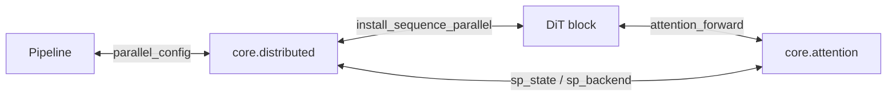

# Enabling Parallel Inference for a Model

This document describes the parallel framework of `DiffSynth-Studio` and its sequence parallelism, and how to enable parallel inference for an existing model. For interface details see the [`diffsynth.core.distributed` API reference](../API_Reference/core/distributed.md); for usage see [Parallel Inference](../Pipeline_Usage/Parallel_Inference.md).

## 1. Parallel Framework Overview

Parallel capabilities live in `diffsynth.core.distributed`, organized in three layers: configuration, foundation, and the parallel strategy itself. Splitting, communication and restoration are performed by the framework; the model only provides declarations.



### 1.1 Configuration (`config.py`)

`ParallelConfig` is the single entry point, accepted by a pipeline's `from_pretrained(parallel_config=...)`. Each parallel capability occupies one field; today that field is `sequence`.

`SequenceParallelConfig` has two fields: `backend` (default `"ulysses"`, `None` disables sequence parallelism) and `gather_between_blocks` (default `False`, explained in 2.2). Both configurations are `frozen=True` dataclasses, modified with `dataclasses.replace`. `ParallelConfig.sp_enabled` tells whether sequence parallelism is enabled.

With no configuration passed, or with a single GPU, installation and dispatch are no-ops.

### 1.2 Foundation (`context.py`, `collectives.py`)

`context.py` manages the process group and devices: `init_parallel` establishes or reuses the communication group through `env://` (environment variables provided by `torchrun`) and binds this process's GPU according to `LOCAL_RANK`; `get_parallel_group` returns the current group; `destroy_parallel` destroys only the group this module created.

`collectives.py` provides differentiable collectives: `all_to_all_4d` (4-D tensors, only `(scatter_dim, gather_dim)` of `(2,1)` or `(1,2)`, the scattered dimension must be divisible by the number of ranks) and `all_gather_sequence` (any dimension, concatenated in rank order, i.e. process index order). Both are `autograd.Function`s whose backward passes are respectively the same exchange with dimensions swapped, and `reduce_scatter`. With a single rank they return the input tensor unchanged.

### 1.3 Sequence Parallelism

Sequence parallelism distributes the token sequence of one sample across GPUs (principles in 2.1). Three submodules cooperate:

| Module | Responsibility |
| --- | --- |
| `sp_hooks` | Automatic sequence splitting framework: reads model declarations, finds runs of repeated blocks, splits at the run's entry and restores at its exit |
| `sp_state` | Sequence parallel state: records whether execution is currently split, plus each input's local length and tail padding |
| `sp_backend` | The sequence parallel node of attention: `attention_forward` performs the exchange here |

## 2. Sequence Parallelism

### 2.1 What Sequence Parallelism Is

Sequence parallelism (SP) distributes **the token sequence of a single sample** across GPUs to shorten that sample's generation time. A DiT encodes images, video and audio into token sequences; higher resolution and more frames mean longer sequences and longer single-GPU runtime, and sequence parallelism shares exactly that computation.

A sequence of length S is cut into P segments for P GPUs, each computing S/P tokens. A DiT is a stack of repeated transformer blocks, and within a block the Linear layers, LayerNorm, activations, residual additions and per-token modulation are all **token-independent**: each GPU computes its own segment with bit-identical results at 1/P of the cost. The one exception is **self-attention**, where every query must see every key. That is where sequence parallelism needs communication.

The framework's approach has two parts: splitting and restoration are attached before and after blocks and happen automatically (see 2.2); attention communicates through Ulysses — one all-to-all before and one after, turning "sequence shards, all heads" into "full sequence, a subset of heads", then back.

```
[B, S/P, H, D] --all-to-all--> [B, S, H/P, D] --local attention--> [B, S, H/P, D] --all-to-all--> [B, S/P, H, D]
 this rank's tokens, all heads   all tokens, subset of heads        kernel unchanged               back to this rank's tokens
```

Here B is batch size, S sequence length, H the number of attention heads and D the per-head dimension. Attention heads are independent of one another, so after splitting by head the kernel sees inputs structurally identical to single-GPU execution — Flash Attention, xFormers, PyTorch SDPA and any other implementation can be reused as is. The price is that head counts must be divisible by the number of ranks; with GQA (fewer K/V heads than Q heads) both counts must satisfy it.

### 2.2 The Automatic Splitting Framework

Splitting and restoration happen outside the model, leaving its `forward` untouched. The mechanism is PyTorch's **forward hook**, which can intercept and modify a module's inputs and outputs around execution: the framework attaches splitting to a block's pre-hook and restoration to its post-hook.

The boundary of splitting is the "stack". A DiT is a stack of repeated blocks, and the framework identifies a run of blocks **under one container, with consecutive indices and one class** as a stack. Splitting happens only at the stack's entry and restoration at its exit, with local shards passed directly between blocks — N blocks pay for one split and one restore.

```
ModuleList([Block, Block, Block, Block])   → one stack: [0,1,2,3]
ModuleList([Block, Other, Block, Block])   → two stacks: [0] and [2,3]
```

Which classes count as blocks is decided by the model's declaration: `sequence_parallel_recipe` on a block class states which dimension of which inputs is the token dimension (see 3.2), and a class carrying that declaration is a block. `Other` in the example has no declaration; it is merely a gap in the indices, runs replicated in full, and therefore separates the surrounding Blocks into two stacks. With `gather_between_blocks=True` every block forms its own stack and sequences are complete between blocks (see Case 5).

This gives the boundary: **shards exist only inside a stack**. Noise initialization, the denoising loop, the scheduler and VAE decoding outside the stack all see full tensors, identical on every rank.

### 2.3 How hook, sp_state and backend Cooperate

Attention is called from inside the model, so whether execution is split is conveyed through a channel outside the model — the thread-local state in `sp_state` (one instance per thread):

1. **Stack entry**: `sp_hooks` splits each input according to its declaration (appending tail padding when the sequence length is not divisible), activates `sp_state`, and records each input's local length and tail padding.
2. **Inside a block**: computation proceeds normally. At `attention_forward` it reads `sp_state`: no state, or state marked as no-exchange → call the local kernel directly, identical to single-GPU; otherwise → delegate to `sp_backend`.
3. **Exchange node**: `sp_backend` performs an all-to-all into head shards, calls the same local kernel, then exchanges back into sequence shards. The output aligns with the local residual, and the block continues on its own segment.
4. **Stack exit**: `sp_hooks` all-gathers the per-rank results back into the full sequence, trims the padding, and deactivates the state.

At most one state instance is active per thread; nesting is not supported.

In some structures the key/value is already complete on every rank, so exchanging it serves no purpose. The recipe expresses these cases with two optional parameters (see 3.2): while a submodule listed in `no_exchange_modules` executes, the state is marked as no-exchange and attention computes the local query against the full K/V directly; the length of a replicated prefix declared through `kv_prefix_inputs` (a KV cache, for instance) is recorded in the state, and `sp_backend` exchanges only the suffix while the prefix is sliced locally by KV heads and prepended, with a single softmax throughout.

## 3. Integrating a Model

### 3.1 Integration Steps

**Step 1: route attention through the unified entry.** Replace the attention calls inside a block with `attention_forward`, keeping the original layout arguments (`b n s d` denotes the order batch, heads, sequence, per-head dimension):

```python
from ..core.attention import attention_forward

out = attention_forward(q, k, v, q_pattern="b n s d", k_pattern="b n s d",
                        v_pattern="b n s d", out_pattern="b n s d")
```

The exchange happens only inside `attention_forward`, so every attention call in a block must go through this entry; bare `F.scaled_dot_product_attention`, `flash_attn_func` and similar calls need to be replaced.

**Step 2: declare the recipe.** Add `sequence_parallel_recipe` to the block class; see 3.2 for the syntax.

**Step 3: pass the configuration through the pipeline.** Add `parallel_config=None` to `from_pretrained` and forward it to `download_and_load_models`. Process group creation and hook installation are handled by the framework.

**Step 4: raise explicitly for unsupported cases.**

```python
from ..core.distributed import current_sequence_parallel_state

if current_sequence_parallel_state() is not None and (attn_mask is not None or kv_cache is not None):
    raise NotImplementedError("... sequence parallelism does not support attention masks or KV caches")
```

**Step 5: verify.** With identical weights, seed and parameters, run three comparisons:

| Comparison | Purpose | Expectation |
| --- | --- | --- |
| Single GPU before vs after the change | Integration did not alter single-GPU behavior | Bit-identical; kernel-level differences when the attention kernel changes |
| Single GPU after the change vs SP | Parallelism is correct | Bit-identical; small deviations when tail padding cannot be excluded |
| Outputs across ranks | Restoration is correct | Exactly identical |

Also record cumulative DiT time and end-to-end time. Compare images pixel-wise (max/mean), video by decoded frames, and audio by waveform.

### 3.2 Writing the Recipe

```python
from ..core.distributed import sequence_parallel_recipe

@sequence_parallel_recipe(
    split_dimensions_for_inputs={"x": 1, "freqs": 0},
    gather_dimensions_for_outputs={"x": 1},
    no_exchange_modules=("cross_attn",),
    kv_prefix_inputs={"kv_prefix": 1},
)
class Block(torch.nn.Module):
    def forward(self, x, freqs, kv_prefix=None):
        ...
        return x
```

Four parameters (the last two are chosen according to the structure; most models need only the first two):

| Parameter | Description |
| --- | --- |
| `split_dimensions_for_inputs` | Input name → token dimension. Each tensor-bearing input is padded and split independently according to its own sequence length |
| `gather_dimensions_for_outputs` | Input name → output gather dimension. **Insertion order is the return-value order**, independent of input order |
| `no_exchange_modules` | Submodule names whose internal attention performs no exchange (their K/V is replicated context) |
| `kv_prefix_inputs` | Replicated-prefix input name → sequence dimension. These inputs are not split; their lengths are summed and used as the K/V prefix |

Key points for input declarations:

* Declare only inputs that carry a token dimension. Per-sample quantities (such as modulation parameters of shape `[B, 6, D]`) are not declared.
* Undeclared arguments pass through untouched; `None` and other non-tensors produce no length entry and must remain non-tensor throughout the stack.
* Tuples and lists (including namedtuples) are traversed recursively; tensor leaves under one argument must share the declared token dimension and length.
* When the sequence length is not divisible, zeros are appended at the tail and trimmed at the exit through the associated input name. Padded tokens take part in attention; to obtain exact agreement, exclude them with `cu_seqlens` (segment boundaries of varlen attention, see Case 6) or a mask.

Key points for output declarations: each key identifies which input's padding amount trims that output, and the value gives the gather dimension (which may differ from the split dimension); keys must appear in the input declaration. A single returned tensor takes one entry; a flat returned tuple/list takes one entry per tensor in return order. When a stream is absent entirely (its input is `None`), that output is returned as is.

Usage of the last two parameters is covered in Cases 2 and 3. Keys of `kv_prefix_inputs` must not appear in `split_dimensions_for_inputs`.

Only a class's own `__dict__` counts for the declaration; subclasses do not inherit it. With VRAM management enabled (`vram_limit`), blocks are replaced by wrapper modules, and the framework unwraps one level to identify the inner class.

### 3.3 Integration Cases

#### Case 1: A Simple Single Stream

All tokens share one set of weights, so declaring the token dimension is enough. Z-Image:

```python
@sequence_parallel_recipe(
    split_dimensions_for_inputs={"x": 1, "freqs_cis": 1, "noise_mask": 1},
    gather_dimensions_for_outputs={"x": 1},
)
```

Per-token companion tensors (RoPE, `noise_mask`) must be declared as well.

The token dimension is not necessarily 1. ERNIE uses a `[S, B, H]` layout and declares `{"x": 0, "rotary_pos_emb": 1, "temb": 0}`, gathering its output along dimension 0 too.

#### Case 2: Replicated Cross-Attention (`no_exchange_modules`)

Text serves only as cross-attention context: this layer does not update it, and every GPU holds a full copy. The query is this rank's tokens and the key/value is the full text, so it can be computed locally. List that submodule in `no_exchange_modules`:

```python
@sequence_parallel_recipe(
    split_dimensions_for_inputs={"x": 1, "freqs_cis": 1, "noise_mask": 1},
    gather_dimensions_for_outputs={"x": 1},
    no_exchange_modules=("cross_attention",),
)
```

Wan, Fibo, ACE-Step, Anima and DiffSynth-Music all fall into this category, with submodule names `cross_attn` or `cross_attention`. Several can be listed: LTX-2 has one text cross-attention per stream, declared as `("attn2", "audio_attn2")`.

While these submodules execute, the framework marks the state as no-exchange and the `attention_forward` inside them uses the local kernel. Submodules may nest, with the depth counted in the state. Self-attention in the same block still exchanges as usual.

#### Case 3: Replicated KV Prefix (`kv_prefix_inputs`)

In some models K/V consists of two parts: a prefix of already-computed, cached tokens (text, reference conditions) held in full on every GPU, and a suffix of the tokens this rank is denoising. Q contains only the suffix.

Exchanging the prefix would gather P redundant copies, while splitting into two attentions and adding them is not equal to one softmax. The framework therefore takes a dedicated path: exchange only the suffix, slice the prefix locally by KV heads and prepend it, completing everything in one softmax (see 2.3).

On the model side, pass the prefix into the block as a separate input and declare it as unsplit through `kv_prefix_inputs`. Qwen-Image-2.1:

```python
@sequence_parallel_recipe(
    split_dimensions_for_inputs={"hidden_states": 1, "rotary_emb": 0, "target_token_mask": 0},
    gather_dimensions_for_outputs={"hidden_states": 1},
    kv_prefix_inputs={"kv_prefix": 1},
)
```

The prefix's sequence dimension follows its own layout: in SenseNova U1 it is dimension 2, declared as `{"kv_prefix": 2}`. The prefix length is taken from this input, and this path does not support `attn_mask`.

The prefix comes from a KV cache, and the pass writing that cache needs the full sequence, so turn parallelism off for it with `sequence_parallel_disabled()` (Case 8).

#### Case 4: Two or More Streams

Some models treat text and image as two streams with independent weights, updated together in joint attention (the two streams concatenated for self-attention). Both streams and their respective RoPE tables must then be declared. FLUX:

```python
@sequence_parallel_recipe(
    split_dimensions_for_inputs={"hidden_states_a": 1, "hidden_states_b": 1,
                                 "image_rotary_emb": 2, "text_rotary_emb": 2},
    gather_dimensions_for_outputs={"hidden_states_a": 1, "hidden_states_b": 1},
)
```

Qwen-Image returns its streams in the reverse of the input order, so the gather declaration follows the return order:

```python
@sequence_parallel_recipe(
    split_dimensions_for_inputs={"image": 1, "text": 1, "image_rotary_emb": 0,
                                 "text_rotary_emb": 0, "modulate_index": 1},
    gather_dimensions_for_outputs={"text": 1, "image": 1},
)
```

Streams have different lengths and are padded and trimmed independently. If a block needs to know where the text ends within this rank's slice, compute it from the two streams' local lengths. LTX-2's video and audio streams carry eight named inputs in total and work the same way.

#### Case 5: Per-Block Splitting (`gather_between_blocks`)

By default the whole stack is split at its entry and restored at its exit, with local shards passed between blocks. If a side computation between blocks needs the full sequence, a local shard cannot feed it. MOVA, for example, has a video tower and an audio tower whose blocks execute alternately, with a bridge operating on the full sequence in between.

Setting `gather_between_blocks` to `True` makes each block its own stack: sequences are complete between blocks and the side computation runs replicated as usual, at the cost of one extra split and restore per block. It is set by the pipeline in the configuration; MOVA sets it automatically when SP is enabled:

```python
parallel_config = replace(parallel_config, sequence=replace(parallel_config.sequence, gather_between_blocks=True))
```

Both configurations are frozen dataclasses, hence the nested `replace`.

#### Case 6: Varlen Attention (`cu_seqlens`)

`cu_seqlens` (cumulative sequence lengths) is the common convention of varlen attention: FlashAttention's `flash_attn_varlen_func` and PyTorch's varlen attention both use it to pack several sequences into one and mark the segment boundaries, and `attention_forward` follows the same convention. After the exchange the sequence is complete, so segment boundaries still apply in global coordinates. It serves three purposes:

**Replacing a per-segment loop.** FLUX.3 originally called attention once per `[start, stop)` segment; when shard boundaries do not coincide with segment boundaries, each segment only receives part of its tokens. Converting the global `bounds` into `cu_seqlens` and calling once solves this.

**Replacing segment ids and dense masks.** Ideogram4's `segment_ids` labels each token's segment, and `cu_seqlens` is computed on the fly from its change points, replacing a `[B, S, S]` dense mask. LingBot packs several samples into one sequence (a packed batch) and obtains segment boundaries by accumulating sample lengths.

**Expressing different attention scopes over the same tokens.** In HiDream-O1 the leading part of the sequence consists of autoregressive (AR) tokens requiring causal attention, while the remaining generated tokens require bidirectional attention; `token_types` labels each token's kind. Two varlen passes compute them separately, then merge using the local `token_types`:

```python
cu_ar = torch.tensor([0, ar_total], dtype=torch.int32, device=q.device)
cu_full = torch.tensor([0, seq_len], dtype=torch.int32, device=q.device)
# Layout arguments are the same as in the single-GPU call and are omitted here
out_ar = attention_forward(q, k, v, ..., is_causal=True, cu_seqlens=cu_ar)
out_full = attention_forward(q, k, v, ..., is_causal=False, cu_seqlens=cu_full)
local_ar = ~token_types[0].bool()   # Already split per the declaration: this rank's segment
out = torch.where(local_ar[None, None, :, None], out_ar, out_full)
```

`ar_total` and `seq_len` are computed from the global `token_types`, while the merge uses the local one.

As a side effect, when `cu_seqlens` covers only the real length, tail padding is naturally excluded from attention.

#### Case 7: Automatic Padding

When the token sequence length is not divisible by the number of ranks, the framework appends zeros at the tail of each input and trims them at the exit through the associated input name. Padded tokens take part in attention, so bit-exact agreement with single-GPU execution requires attention to know the real sequence length:

* **Keep a mask whose length is the real sequence length S.** ERNIE's key mask at `B == 1` is already all-True and imposes no constraint, but its length lets the framework trim the padding at the tail of k/v.
* **Repack and use an all-True mask.** Krea2's valid tokens have holes in between, and `cu_seqlens` cannot merge two disjoint valid regions into one segment, so the valid tokens are repacked into a contiguous sequence via `mask[0].nonzero()` and the mask becomes all-True, which likewise trims the tail padding.

When padding lands **in the middle of a local sequence** it cannot be trimmed: Boogu pads each stream separately after concatenating two streams, placing padding in the middle of the local sequence, and ACE-Step's short sequences behave the same way. Padded tokens participate in attention and introduce small deviations.

#### Case 8: `sequence_parallel_disabled`

Some functions cannot be parallelized. `sequence_parallel_disabled()` turns parallelism off for that function so it runs in full, without disturbing the parallelism elsewhere — the stack remains installed, and only this pass skips splitting and restoration.

The typical case is the prefix encoding that writes a KV cache: it needs the full sequence, and the resulting cache later serves as a replicated prefix for sharded forwards. SenseNova turns parallelism off for these two functions:

```python
@sequence_parallel_disabled()
def encode_prefix(self, ...):
    ...

@sequence_parallel_disabled()
@torch.no_grad()
def generate_think(self, ...):
    ...
```

The denoising pass is sharded normally, with the cached keys declared as a replicated prefix through `kv_prefix_inputs`. Qwen-Image-2.1 works the same way: the first step `_forward_unsplit` turns parallelism off, applies segmented causal attention to the full joint sequence (text and image tokens concatenated into one) and writes the cache, while later decoding steps shard only the image tokens being generated.

It works both as a context manager and as a decorator, and affects only the pass it wraps.

### 3.4 A Minimal Runnable Example

A block with self-attention runs on multiple GPUs once its token dimension is declared:

```python
import torch
from diffsynth.core.attention import attention_forward
from diffsynth.core.distributed import ParallelConfig, init_parallel, install_sequence_parallel, sequence_parallel_recipe

@sequence_parallel_recipe(
    split_dimensions_for_inputs={"x": 1},
    gather_dimensions_for_outputs={"x": 1},
)
class Block(torch.nn.Module):
    def __init__(self, dim=64, heads=4):
        super().__init__()
        self.heads = heads
        self.norm = torch.nn.LayerNorm(dim, elementwise_affine=False)
        self.qkv = torch.nn.Linear(dim, dim * 3)
        self.proj = torch.nn.Linear(dim, dim)

    def forward(self, x):
        b, s, d = x.shape
        q, k, v = self.qkv(self.norm(x)).chunk(3, dim=-1)
        q, k, v = (t.view(b, s, self.heads, d // self.heads) for t in (q, k, v))
        out = attention_forward(q, k, v, q_pattern="b s n d", k_pattern="b s n d",
                                v_pattern="b s n d", out_pattern="b s n d")
        return x + self.proj(out.reshape(b, s, d))

class Model(torch.nn.Module):
    def __init__(self):
        super().__init__()
        self.blocks = torch.nn.ModuleList([Block() for _ in range(4)])

init_parallel()
torch.manual_seed(0)          # Weights must match across ranks; real models load one checkpoint
model = Model().cuda()
install_sequence_parallel(model, ParallelConfig())
torch.manual_seed(1)
x = torch.randn(1, 128, 64, device="cuda")
for block in model.blocks:
    x = block(x)
print(x.shape)                # (1, 128, 64), the full sequence restored at the exit
```

```bash
torchrun --standalone --nproc_per_node=2 example.py
```