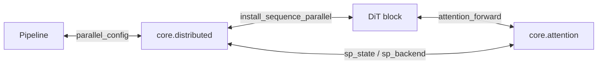

# 启用模型的并行推理能力

本文档介绍 `DiffSynth-Studio` 的并行框架，以及如何为已有模型启用并行推理。接口细节见 [`diffsynth.core.distributed` API 参考](../API_Reference/core/distributed.md)，使用方式见[并行推理](../Pipeline_Usage/Parallel_Inference.md)。

## 1. 并行框架总览

并行能力集中在 `diffsynth.core.distributed`，分为配置、底层、具体并行策略三层。

并行按**轴**组织：一个轴对应一种并行能力，各轴只在自己的进程组上通信，因此可以组合。当前有两个轴：

| 轴 | 切分什么 | 作用位置 | 模型侧要做什么 |
| --- | --- | --- | --- |
| 序列并行 | 一条样本的 token 序列 | DiT 的 block 栈 | 在 block 类上声明 token 维 |
| CFG 并行 | guidance 的正负两次前向 | pipeline 的去噪循环 | 无需改动 |

总卡数是各轴 size 之积。两个轴各自独立通信，一支内部的 collective 次数与另一支不同也不会互相阻塞。



### 1.1 配置（`config.py`）

`ParallelConfig` 是统一入口，由 pipeline 的 `from_pretrained(parallel_config=...)` 接收，各轴在其中各占一个平级字段：`sequence` 与 `cfg`，默认都是 `None`，**传入对应的轴配置才启用该轴**。新增一种并行能力就是新增一个轴字段。

`SequenceParallelConfig` 的字段：`backend`（默认 `"ulysses"`）、`gather_between_blocks`（默认 `False`，含义见 2.2）。

`CFGParallelConfig` 目前没有字段，传入即启用，该轴 size 为 2，对应 guidance 的正负两支。

轴配置都是 `frozen=True` 的 dataclass，修改用 `dataclasses.replace`；`ParallelConfig.sequence_enabled` 与 `cfg_enabled` 分别表示两个轴是否启用。

未传配置或卡数为 1 时，安装与分派为空操作。

### 1.2 底层（`context.py`、`collectives.py`）

`context.py` 管进程组与设备：`init_parallel` 通过 `env://` 建立或复用通信组（环境变量由 `torchrun` 提供），按 `LOCAL_RANK` 绑定本进程的卡，再按配置划分各轴；`destroy_parallel` 只销毁本模块创建的组。

各轴由模块级唯一的 `ParallelContext` 实例 `parallel_context` 持有，取组是它的方法：`get_world_group()` / `get_sequence_group()` / `get_cfg_group()`，配套 `get_*_rank()` 与 `get_*_world_size()`。**轴未启用时组为 `None`**。

两个轴都启用时用命名维度的 `DeviceMesh` 划分，顺序 `("cfg", "sequence")`：序列轴在最内层拿相邻 rank（它每个 block 都要 all-to-all），CFG 轴在外层跨步（它每步只交换一次预测）。只有一个轴 size 大于 1 时，该轴覆盖全部 rank，直接用 world 组。

`collectives.py` 提供可微的集合通信：`all_to_all_4d`（4 维张量，只支持 `(scatter_dim, gather_dim)` 为 `(2,1)` 或 `(1,2)`，被切维长度须被卡数整除）与 `all_gather_sequence`（任意维，按 rank 即进程序号顺序拼接）。两者都是 `autograd.Function`，反向分别是交换维度重做、`reduce_scatter`；卡数为 1 时直接返回原张量。

### 1.3 序列并行轴

序列并行把一条样本的 token 序列分给多卡计算（原理见 2.1），由三个子模块协作实现：

| 模块 | 职责 |
| --- | --- |
| `sp_hooks` | 序列自动切分框架：读模型声明、找出重复的 block 段、在段的入口切分与出口还原 |
| `sp_state` | 序列并行状态：记录当前是否处于切分中、各输入切分后的长度与尾部补齐量 |
| `sp_backend` | attention 的序列并行节点：`attention_forward` 在此完成交换 |


### 1.4 CFG 并行轴

CFG 并行把 guidance 的两次前向分给两组卡（原理见 4.1）。它不改模型，调度集中在 `BasePipeline.cfg_guided_model_fn`——pipeline 去噪循环里 CFG 的统一入口。模型侧无需声明，pipeline 侧只要把两次前向交给这个入口。


## 2. 序列并行

### 2.1 序列并行是什么

序列并行（Sequence Parallel，下称 SP）把**同一个样本的 token 序列**分给多张卡计算，缩短单个样本的生成时间。DiT 把图像、视频、音频都编码成 token 序列，分辨率与帧数越高序列越长，单卡耗时随之增长，序列并行分担的就是这部分计算。

长度为 S 的序列切成 P 段分给 P 张卡，每卡计算 S/P 个 token。DiT 由重复的 transformer block 堆叠而成，一个 block 里的 Linear、LayerNorm、激活、残差相加、逐 token 调制都是**逐 token 独立**的计算，每卡算自己那段即与单卡逐位相同，耗时降到 1/P。唯一的例外是**自注意力**：每个 query 要看到全部 key，这是序列并行需要通信的地方。

框架的方案由两部分组成：序列的切分与还原挂在 block 前后自动完成（见 2.2）；注意力处用 Ulysses 通信——前后各一次 all-to-all，把「序列分片、全部头」换成「全部序列、部分头」，算完再换回。

```
[B, S/P, H, D] --all-to-all--> [B, S, H/P, D] --本地注意力--> [B, S, H/P, D] --all-to-all--> [B, S/P, H, D]
 本 rank 的 token、全部头         全部 token、部分头              内核无需修改                回到本 rank 的 token
```

式中 B 为批大小、S 为序列长度、H 为注意力头数、D 为每头维数。注意力头之间彼此独立，因此按头切分后内核看到的输入与单卡同构——Flash Attention、xFormers、PyTorch SDPA 等任何实现都能直接复用。代价是头数必须被卡数整除；GQA（K/V 头数少于 Q 头数）下两者都要满足。

### 2.2 自动切分框架

切分与还原由框架在模型之外完成，模型的 `forward` 保持原样。落地手段是 PyTorch 的 **forward hook**：它能在模块执行前后拦截并修改输入与输出，框架把切分挂在 block 的前 hook、还原挂在后 hook。

切分的边界是「栈」。DiT 由重复的 block 堆叠而成，框架把**同一容器下索引连续、类相同**的一段 block 识别为一个栈，只在栈的入口切分、出口还原，块间直接传递局部分片——N 个 block 只付一次切分与还原的代价。

```
ModuleList([Block, Block, Block, Block])   → 一个栈：[0,1,2,3]
ModuleList([Block, Other, Block, Block])   → 两个栈：[0] 与 [2,3]
```

哪些类算 block 由模型声明决定：在 block 类上用 `sequence_parallel_recipe` 写出哪些输入的哪一维是 token 维（写法见 3.2），带声明的类即 block。上例的 `Other` 没有声明，只是索引上的间隔，它整份复制运行，前后的 Block 因此被切成两个栈。`gather_between_blocks=True` 时每个 block 各自成栈、块间序列完整（见案例 5）。

由此得到边界：**分片只存在于栈内部**。栈外的噪声初始化、去噪循环、scheduler、VAE 解码看到的都是完整张量，各 rank 一致。

### 2.3 hook、sp_state、backend 怎么配合

注意力在模型内部被调用，分片与否通过模型之外的信道传达——`sp_state` 的线程局部状态（每个线程各自一份）：

1. **栈入口**：`sp_hooks` 按声明切分各输入（序列长度不整除时尾部补齐），激活 `sp_state`，记录各输入切分后的长度与尾部补齐量。
2. **block 内部**：计算照常。走到 `attention_forward` 时它读 `sp_state`：无状态或状态标记为不交换 → 直接调本地内核，与单卡一致；否则 → 委托 `sp_backend`。
3. **交换节点**：`sp_backend` 做 all-to-all 换到头分片，调同一个本地内核，再换回序列分片。输出与本地残差对齐，block 继续在自己那段上算。
4. **栈出口**：`sp_hooks` 把各卡结果 all-gather 拼回完整序列、裁掉补齐，注销状态。

状态每线程至多一个活跃实例，不支持嵌套。

有些结构的 key/value 在各卡都是完整的，交换它们没有意义。recipe 用两个可选参数表达这类情况（写法见 3.2）：`no_exchange_modules` 列出的子模块执行期间，状态标记为不交换，注意力直接用本地 query 对完整 K/V 计算；`kv_prefix_inputs` 声明的复制前缀（如 KV cache）长度记在状态里，`sp_backend` 只交换后缀，前缀按 KV 头本地切片后拼回，全程一次 softmax。

## 3. 接入序列并行

### 3.1 接入步骤

**第一步，注意力走统一入口。** 把 block 内的注意力调用改为 `attention_forward`，保留原有的布局参数（`b n s d` 表示批、头、序列、每头维数的排列顺序）：

```python
from ..core.attention import attention_forward

out = attention_forward(q, k, v, q_pattern="b n s d", k_pattern="b n s d",
                        v_pattern="b n s d", out_pattern="b n s d")
```

交换只发生在 `attention_forward` 内部，因此 block 内的注意力都要走这个入口，裸 `F.scaled_dot_product_attention`、`flash_attn_func` 等调用要替换掉。

**第二步，声明 recipe。** 在 block 类上加 `sequence_parallel_recipe`，写法见 3.2。

**第三步，pipeline 透传配置。** `from_pretrained` 增加 `parallel_config=None` 并传给 `download_and_load_models`。进程组建立与 hook 安装都由框架完成。

**第四步，不支持的场景显式报错。**

```python
from ..core.distributed import current_sequence_parallel_state

if current_sequence_parallel_state() is not None and (attn_mask is not None or kv_cache is not None):
    raise NotImplementedError("... sequence parallelism does not support attention masks or KV caches")
```


**第五步，验证。** 同权重、同 seed、同参数，跑三组比对：

| 比对 | 目的 | 期望 |
| --- | --- | --- |
| 改造前单卡 vs 改造后单卡 | 接入没有改变单卡行为 | 逐位一致；注意力内核变化时会有内核级差异 |
| 改造后单卡 vs SP | 并行正确 | 逐位一致；尾部补齐无法排除时有微小偏差 |
| 各 rank 输出互比 | 拼回正确 | 完全一致 |

同时记录 DiT 累计耗时与端到端耗时。图像比逐像素 max/mean，视频比解码帧，音频比波形。

### 3.2 recipe 怎么写

```python
from ..core.distributed import sequence_parallel_recipe

@sequence_parallel_recipe(
    split_dimensions_for_inputs={"x": 1, "freqs": 0},
    gather_dimensions_for_outputs={"x": 1},
    no_exchange_modules=("cross_attn",),
    kv_prefix_inputs={"kv_prefix": 1},
)
class Block(torch.nn.Module):
    def forward(self, x, freqs, kv_prefix=None):
        ...
        return x
```

四个参数（后两个按结构选用，多数模型只需前两个）：

| 参数 | 说明 |
| --- | --- |
| `split_dimensions_for_inputs` | 输入名 → token 维。每个带张量的输入按自己的序列长度独立补齐并切分 |
| `gather_dimensions_for_outputs` | 输入名 → 输出 gather 维。**插入顺序即返回值顺序**，与输入顺序无关 |
| `no_exchange_modules` | 子模块名，其内部注意力不交换（K/V 是复制的上下文） |
| `kv_prefix_inputs` | 复制前缀输入名 → 序列维。这些输入不切分，长度求和后作为 K/V 前缀 |

输入声明的要点：

* 只声明带 token 维的输入。per-sample 的量（如 `[B, 6, D]` 的调制参数）不声明。
* 未声明的参数原样透传；`None` 与其它非张量不产生长度条目，且须在整个栈内保持非张量。
* tuple/list（含 namedtuple）递归遍历，同一参数下的张量叶子须共享声明的 token 维与长度。
* 序列长度不整除时尾部补零，出口按关联输入名裁掉。补齐 token 会参与注意力计算，需要精确一致时用 `cu_seqlens`（变长注意力的段边界，见案例 6）或 mask 排除。

输出声明的要点：每个键标识「用哪个输入的补齐量裁剪这个输出」，值给出 gather 维（可与切分维不同）；键必须出现在输入声明中。返回单张量声明一项，返回扁平 tuple/list 按返回顺序逐项声明。某条流整体缺席（对应输入为 `None`）时该输出原样返回。

后两个参数的用法见案例 2 与案例 3。`kv_prefix_inputs` 的键不得出现在 `split_dimensions_for_inputs` 中。

声明只认类自己的 `__dict__`，子类不继承。开启显存管理（`vram_limit`）后 block 会被换成包装模块，框架拆一层识别内层类。

### 3.3 接入案例

#### 案例 1：简单的单流

所有 token 共用一套权重，声明 token 维即可。Z-Image：

```python
@sequence_parallel_recipe(
    split_dimensions_for_inputs={"x": 1, "freqs_cis": 1, "noise_mask": 1},
    gather_dimensions_for_outputs={"x": 1},
)
```

逐 token 的伴随张量（RoPE、`noise_mask`）要一起声明。

token 维不一定是 1。ERNIE 的布局是 `[S, B, H]`，声明为 `{"x": 0, "rotary_pos_emb": 1, "temb": 0}`，输出同样按 0 维拼回。

#### 案例 2：复制的 cross-attention（`no_exchange_modules`）

文本只作为 cross-attention 的上下文：它不被这一层更新，每张卡都持有完整副本。query 是本 rank 的 token、key/value 是完整文本，本地直接算即可。把该子模块名列入 `no_exchange_modules`：

```python
@sequence_parallel_recipe(
    split_dimensions_for_inputs={"x": 1, "freqs_cis": 1, "noise_mask": 1},
    gather_dimensions_for_outputs={"x": 1},
    no_exchange_modules=("cross_attention",),
)
```

Wan、Fibo、ACE-Step、Anima、DiffSynth-Music 都属这一类，子模块名各自是 `cross_attn` 或 `cross_attention`。可以列多个：LTX-2 的两条流各有一个文本 cross-attention，声明为 `("attn2", "audio_attn2")`。

框架在这些子模块执行期间把状态标记为「不交换」，其内部的 `attention_forward` 走本地内核；子模块可嵌套，深度由状态计数。同一 block 里的自注意力仍照常交换。

#### 案例 3：复制的 KV 前缀（`kv_prefix_inputs`）

有些模型的 K/V 由两段拼成：前缀是已算好并缓存的 token（文本、参考条件），每张卡持有完整一份；后缀是本 rank 正在去噪的 token，Q 只有后缀。

前缀跟着交换会被重复 gather P 份，拆成两次注意力相加又不等于一次 softmax。框架为此走专门路径：只交换后缀，前缀按 KV 头本地切片后拼回，一次 softmax 完成（见 2.3）。

模型侧把前缀作为一个独立输入传进 block，用 `kv_prefix_inputs` 声明它不切分。Qwen-Image-2.1：

```python
@sequence_parallel_recipe(
    split_dimensions_for_inputs={"hidden_states": 1, "rotary_emb": 0, "target_token_mask": 0},
    gather_dimensions_for_outputs={"hidden_states": 1},
    kv_prefix_inputs={"kv_prefix": 1},
)
```

前缀的序列维按它自己的布局声明：SenseNova U1 的前缀序列维在 2，声明为 `{"kv_prefix": 2}`。前缀长度取自这个输入，该路径不支持 `attn_mask`。

前缀来自 KV cache，写缓存的那一遍需要完整序列，用 `sequence_parallel_disabled()` 关掉并行（案例 8）。

#### 案例 4：双流 / 多流

有些模型把文本与图像作为两条流，各有独立权重，并在联合注意力（两条流拼在一起做自注意力）中一起更新。这时两条流与各自的 RoPE 都要声明。FLUX：

```python
@sequence_parallel_recipe(
    split_dimensions_for_inputs={"hidden_states_a": 1, "hidden_states_b": 1,
                                 "image_rotary_emb": 2, "text_rotary_emb": 2},
    gather_dimensions_for_outputs={"hidden_states_a": 1, "hidden_states_b": 1},
)
```

Qwen-Image 的返回顺序与输入顺序相反，gather 声明按返回顺序写：

```python
@sequence_parallel_recipe(
    split_dimensions_for_inputs={"image": 1, "text": 1, "image_rotary_emb": 0,
                                 "text_rotary_emb": 0, "modulate_index": 1},
    gather_dimensions_for_outputs={"text": 1, "image": 1},
)
```

各流长度不同，各自补齐、各自裁剪。块内若要知道本 rank 切片里文本到哪结束，用两条流各自的局部长度计算。LTX-2 的 video/audio 两条流共 8 个命名输入，同理。

#### 案例 5：逐块切分（`gather_between_blocks`）

默认整个栈只在入口切分、出口还原，块间传递局部分片。若块间存在需要完整序列的旁路计算，局部分片就喂不进去。例如 MOVA 有视频与音频两个塔，两塔的 block 交替执行，中间夹着一座对完整序列运行的桥。

这时把 `gather_between_blocks` 置 `True`，每个 block 各自成栈：块间序列完整，旁路计算照常复制运行，代价是每块多一次切分与还原。它由 pipeline 在配置里设置，MOVA 启用 SP 时自动置位：

```python
parallel_config = replace(parallel_config, sequence=replace(parallel_config.sequence, gather_between_blocks=True))
```

两个配置都是 frozen dataclass，因此需要双层 `replace`。

#### 案例 6：varlen attention（`cu_seqlens`）

`cu_seqlens`（累积序列长度）是变长注意力（varlen attention）的通用约定：FlashAttention 的 `flash_attn_varlen_func` 与 PyTorch 的变长注意力都用它把多条序列打包成一条、并标出各段边界，`attention_forward` 沿用了这一约定。交换后序列完整，段边界仍按全局坐标生效。它有三种用途：

**替代按段循环。** FLUX.3 原本对每个 `[start, stop)` 段各调一次注意力，分片边界与段边界不重合时每段只拿到一部分。改成把全局 `bounds` 转成 `cu_seqlens`、一次调用即可。

**替代段编号与稠密 mask。** Ideogram4 的 `segment_ids` 逐 token 标记所属段，由其变化点现场算出 `cu_seqlens`，取代 `[B, S, S]` 的稠密 mask；LingBot 把多个样本打包成一条序列（packed batch），用各样本长度累加得到段边界。

**表达同一批 token 上的不同注意力范围。** HiDream-O1 的序列里，前一段是自回归（AR）token、需要因果注意力，其余是生成 token、需要双向注意力。`token_types` 逐 token 标记属于哪一类。用两遍 varlen 分别计算，再按本地的 `token_types` 合并：

```python
cu_ar = torch.tensor([0, ar_total], dtype=torch.int32, device=q.device)
cu_full = torch.tensor([0, seq_len], dtype=torch.int32, device=q.device)
# 布局参数与单卡调用一致，此处省略
out_ar = attention_forward(q, k, v, ..., is_causal=True, cu_seqlens=cu_ar)
out_full = attention_forward(q, k, v, ..., is_causal=False, cu_seqlens=cu_full)
local_ar = ~token_types[0].bool()   # 已按声明切分，是本 rank 的那段
out = torch.where(local_ar[None, None, :, None], out_ar, out_full)
```

`ar_total` 与 `seq_len` 用全局 `token_types` 计算，合并用本地的那份。

顺带：`cu_seqlens` 只覆盖真实长度时，尾部补齐自然被排除在注意力之外。

#### 案例 7：自动 padding

token 序列长度不被卡数整除时，框架在各输入尾部补零，出口按关联输入名裁掉。补齐 token 会参与注意力，要做到与单卡逐位一致，需要让注意力知道真实序列长度：

* **保留一个长度为真实序列长 S 的 mask。** ERNIE 在 `B == 1` 下的 key mask 本就全 True、不起约束作用，但它的长度让框架截掉 k/v 尾部的补齐。
* **重排打包 + 全 True mask。** Krea2 的有效 token 中间有空洞，`cu_seqlens` 无法把两段不连续的有效区合成一个段，于是按 `mask[0].nonzero()` 把有效 token 重排成连续序列、mask 换成全 True，同样截掉尾部补齐。

补齐落在**局部序列中段**时无法截除：Boogu 双流拼接后各流分别补齐，补齐位置在局部序列中间；ACE-Step 的短序列同理。补齐 token 参与注意力计算，会带来微小偏差。

#### 案例 8：`sequence_parallel_disabled`

有些函数无法并行。用 `sequence_parallel_disabled()` 把这个函数的并行直接关掉，让它整份运行，避免干扰其它部分的并行——栈仍安装着，只是这一遍跳过切分与还原。

典型是写 KV cache 的前缀编码：它需要完整序列，产出的缓存随后作为复制前缀供分片前向使用。SenseNova 把这两个函数关掉并行：

```python
@sequence_parallel_disabled()
def encode_prefix(self, ...):
    ...

@sequence_parallel_disabled()
@torch.no_grad()
def generate_think(self, ...):
    ...
```

denoise 遍正常分片，缓存 keys 由 `kv_prefix_inputs` 声明为复制前缀。Qwen-Image-2.1 同理：首步 `_forward_unsplit` 关掉并行，对完整的联合序列（文本与图像 token 拼成一条）做分段因果注意力并写 cache，后续解码步只分片待生成的图像 token。

它既是上下文管理器也是装饰器，只影响包住的那一遍。

### 3.4 一个可运行的最小例子

一个带自注意力的 block，声明 token 维后即可跑在多卡上：

```python
import torch
from diffsynth.core.attention import attention_forward
from diffsynth.core.distributed import ParallelConfig, SequenceParallelConfig, init_parallel, install_sequence_parallel, sequence_parallel_recipe

@sequence_parallel_recipe(
    split_dimensions_for_inputs={"x": 1},
    gather_dimensions_for_outputs={"x": 1},
)
class Block(torch.nn.Module):
    def __init__(self, dim=64, heads=4):
        super().__init__()
        self.heads = heads
        self.norm = torch.nn.LayerNorm(dim, elementwise_affine=False)
        self.qkv = torch.nn.Linear(dim, dim * 3)
        self.proj = torch.nn.Linear(dim, dim)

    def forward(self, x):
        b, s, d = x.shape
        q, k, v = self.qkv(self.norm(x)).chunk(3, dim=-1)
        q, k, v = (t.view(b, s, self.heads, d // self.heads) for t in (q, k, v))
        out = attention_forward(q, k, v, q_pattern="b s n d", k_pattern="b s n d",
                                v_pattern="b s n d", out_pattern="b s n d")
        return x + self.proj(out.reshape(b, s, d))

class Model(torch.nn.Module):
    def __init__(self):
        super().__init__()
        self.blocks = torch.nn.ModuleList([Block() for _ in range(4)])

parallel_config = ParallelConfig(sequence=SequenceParallelConfig())
init_parallel(parallel_config=parallel_config)
torch.manual_seed(0)          # 各 rank 权重需一致；真实模型由同一份 checkpoint 加载
model = Model().cuda()
install_sequence_parallel(model, parallel_config)
torch.manual_seed(1)
x = torch.randn(1, 128, 64, device="cuda")
for block in model.blocks:
    x = block(x)
print(x.shape)                # (1, 128, 64)，出口已还原完整序列
```

```bash
torchrun --standalone --nproc_per_node=2 example.py
```

## 4. CFG 并行

### 4.1 CFG 并行是什么

classifier-free guidance（CFG）是扩散模型常用的采样增强手段：每一步用同一个 latent 跑两次前向，一次条件于正 prompt、一次条件于负 prompt，得到 `posi` 与 `nega`，再按

```
noise_pred = nega + cfg_scale * (posi - nega)
```

组合出这一步的预测。`cfg_scale` 越大，生成结果越贴近正 prompt。

这两次前向彼此独立——同一个 latent、同一份权重，只有条件输入不同。CFG 并行就是把它们分到两组卡上同时算，每张卡只跑一支。它切分的是**两次独立的前向**，与序列并行切分**一次前向内部的 token** 是不同维度，因此可以叠加：`cfg_size × sp_size` 张卡，每张卡跑一支的一部分 token。

### 4.2 分支拆分与合并

CFG 轴 size 为 2，两组的划分见 1.2。一步的流程：

1. `cfg_rank == 0` 的那组卡算正支，另一组算负支
2. 沿 batch 维在 CFG 轴上 `all_gather`，两组都拿到两支的预测
3. 各卡本地按原式组合

`all_gather` 是对称的：每张卡交出自己那支，也都收到全部两支。所以组合之后各卡的 `noise_pred` 完全一致，`scheduler.step` 也各自本地执行，全程不需要广播。

选择 all_gather 而不是「各卡算加权贡献再求和」，是因为前者保住了两支的原始预测。有些模型在组合之后还要用其中一支做归一化，拿不到原始值就无法实现。

通信量是每步一个 latent，相比序列并行每个 block 两次激活 all-to-all 可以忽略。

### 4.3 接入 pipeline

把去噪循环里手写的两次前向交给统一入口：

```python
for progress_id, timestep in enumerate(self.scheduler.timesteps):
    noise_pred = self.cfg_guided_model_fn(
        self.model_fn, cfg_scale, inputs_shared, inputs_posi, inputs_nega,
        **models, timestep=timestep,
    )
    inputs_shared["latents"] = self.step(self.scheduler, progress_id=progress_id,
                                        noise_pred=noise_pred, **inputs_shared)
```

入口对每支的调用形态是 `model_fn(**inputs_branch, **inputs_shared, **inputs_others)`。**两支之间的差异全部通过分支字典表达。**

#### 案例：两支用不同的模型

有些模型给负支单独训了一份权重。模型对象本身也是 `model_fn` 的一个关键字参数，放进分支字典即可：

```python
inputs_posi["dit"] = self.dit
inputs_nega["dit"] = self.dit_uncond if self.dit_uncond is not None else self.dit
noise_pred = self.cfg_guided_model_fn(
    self.model_fn, cfg_scale, inputs_shared, inputs_posi, inputs_nega, timestep=timestep
)
```

入口按 `cfg_rank` 选分支字典，于是每组卡自然用到自己那份权重。

#### 案例：把两支合成一次 batch 前向

有的 pipeline 提供把正负条件沿 batch 维拼起来、一次前向算完两支的选项。这种形态下只有一次前向可分，CFG 轴没有可拆的对象，两者互斥，需要在启用时显式报错。

### 4.4 约束

| 项 | 说明 |
| --- | --- |
| `cfg_scale` | 必须不等于 1。等于 1 时没有负分支，另一组卡无事可做，入口直接抛 `ValueError` |
| 输出形状 | 两支输出的形状必须相同。输入长度可以不同——例如负 prompt 更短、甚至没有文本 token——只要 `model_fn` 返回的是同形状的 latent 预测 |
| 跨支共享的可变状态 | 两支在不同进程上执行。放在共用输入里的缓存计数器会各自独立累积，跳步决策随之与单卡不同。此类状态要按分支分开保存 |
| 头数整除 | 只约束序列轴的 size。CFG 轴不参与 attention 的交换，与头数无关 |
